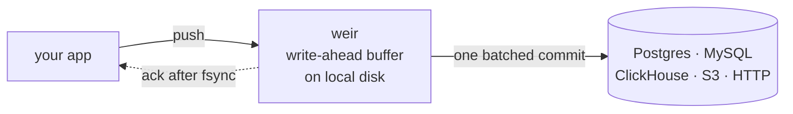

<div align="center">

# weir

**Stop doing one INSERT per event.**

A durable write buffer daemon. Your app gets an ack once a record is on local
disk; weir commits records to your database in batches and replays them after a
crash.

[](https://github.com/miki-przygoda/weir/actions/workflows/ci.yml)
[](https://crates.io/crates/weir-server)
[](https://docs.rs/weir-rs)
[](Cargo.toml)
[](LICENSE)

[Documentation](https://miki-przygoda.github.io/weir/) ·
[Quickstart](docs/getting-started/quickstart.md) ·
[Live demo](https://www.mikolaj-mikuliszyn.dev/demo/weir) ·
[Comparisons](docs/comparisons/README.md) ·
[Changelog](CHANGELOG.md)

</div>

---

Writing every event straight to the database is slow, and holding events in
memory loses them on a crash. weir sits between the two: a small daemon on the
same host as your application that makes each write durable locally, acks it,
and turns many writes into one commit downstream.



## Highlights

- **An ack is never a false ack.** At the `Durable` tier the ack waits for a
  local fsync, and an acked record is delivered even if the machine loses power
  immediately afterwards. Tested with 5,311 simulated power cuts:
  42,814,591 acked records, none lost.
- **Choose the cost per record.** `Buffered` acks before the fsync for a p50 of
  19 µs, against 1.1 ms for `Durable`. It survives a process crash but can lose
  up to ~30 MB of acked records on power loss.
- **Your database can be down.** Records keep buffering on disk and drain when
  it returns. Batches the sink rejects go to a dead-letter directory that
  `weir-ctl` can list, drop or requeue.
- **No broker to operate.** One binary per host. Clients for Rust, Python, Go,
  C, Java and TypeScript, plus language-neutral
  [conformance vectors](docs/conformance.md) for writing your own.
- **Observable.** `/livez`, `/readyz` and `/startupz` probes, a `/status`
  document and Prometheus metrics, with
  [alerts and a Grafana dashboard](docs/monitoring.md).

## Quickstart

Install the daemon and the admin CLI, or use the
[container image](docs/getting-started/install.md):

```bash
cargo install weir-server weir-ctl
```

Start it with a sink:

```bash
mkdir -p /tmp/weir/wab /tmp/weir/run && chmod 0700 /tmp/weir/run
weir-server \
    --wab-dir /tmp/weir/wab \
    --socket-path /tmp/weir/run/weir.sock \
    --sink-type http --sink-url https://your-endpoint.example/ingest
```

Push a record from the shell:

```bash
weir-ctl push --socket /tmp/weir/run/weir.sock 'hello, weir!'
# ack  12 bytes, Durable
```

Or from Rust, with `weir-client = "4.1"`:

```rust
use weir_client::{Durability, WeirClient};

fn main() -> Result<(), Box<dyn std::error::Error>> {
    let mut client = WeirClient::connect("/tmp/weir/run/weir.sock")?;
    client.push(b"hello, weir!", Durability::Durable)?; // returns once fsync'd
    Ok(())
}
```

> [!IMPORTANT]
> - **An ack means buffered, not delivered.** Records reach the sink when a WAB
>   segment seals. Without `--sink-type`, the `noop` sink discards everything.
> - **`push()` blocks.** From async code, use the
>   [async bridge](docs/getting-started/integrating.md#producing-from-an-async-runtime).
> - **The daemon runs on Linux and macOS.** Windows producers connect over
>   [TCP with mutual TLS](docs/operations/tcp-mtls.md). Power-loss durability is
>   claimed for Linux only; see [platform support](docs/platform-support.md).

The [full quickstart](docs/getting-started/quickstart.md) covers configuration
files, sinks and the delivery details.

## Durability tiers

The producer chooses the tier for each record.

| | `Durable` | `Buffered` |
|---|---|---|
| Ack is sent | after the record is fsync'd | after the record is in memory |
| Survives a process crash | yes | yes |
| Survives power loss | **yes** | up to ~30 MB of acked records may be lost |
| Ack latency, p50 | 1.1 ms | 19 µs |

Latencies are from a [bare-metal capture](docs/benchmarks/bare-metal.md) on an
i9-9900K with a SATA SSD. A `Durable` ack waits for one fsync, so its latency is
your disk's, not weir's.

## How the guarantee is tested

- **Simulated power loss on a real kernel.** Each cut drops every write the disk
  had not flushed, at the block layer under ext4. 5,311 cuts at the `Durable`
  tier lost no acked record, and a canary block confirmed the fault fired every
  time ([method and results](docs/benchmarks/chaos-phase2/2026-08-28-first-power-loss-measurement.md)).
  The same harness measured `Buffered`'s exposure as uniform up to a ceiling of
  about 30 MB ([write-up](docs/benchmarks/chaos-phase2/2026-09-27-buffered-ceiling-is-bytes.md)).
- **Deterministic simulation.** The buffer's durability invariants are checked
  under injected crash and fault schedules with replayable seeds, 300 seeds on
  every CI run ([architecture](docs/architecture.md#testing-infrastructure)).
- **Conformance vectors.** Canonical frames and the results a decoder must
  produce, so a client in any language can be checked against the wire format
  ([conformance](docs/conformance.md)).
- **Integration tests and fuzzing.** The SQL sinks run against real MySQL,
  Postgres and ClickHouse ([sink integration](docs/testing/sink-integration.md)),
  and the parsers at the trust boundary are fuzzed ([fuzzing](docs/testing/fuzzing.md)).

## When to use weir

**Use it when** an application produces records faster than its database wants
to commit them. Typical cases are ClickHouse's "too many parts" from small
inserts, an INSERT per event into Postgres or MySQL, and an edge host whose
uplink comes and goes.

**Use something else when**

- the write must be atomic with your own database transaction: use an outbox
  table;
- you need pub/sub, several consumers or replayable topics: use a broker such as
  Kafka, Redpanda or NATS;
- you need to transform and route telemetry to many destinations: use Vector or
  Fluent Bit;
- writing straight to the database is already fast enough.

The [comparison pages](docs/comparisons/README.md) cover ClickHouse async
inserts, Vector and Fluent Bit, and the outbox pattern in detail, with sources.

## Delivery semantics

- **At-least-once.** A crash or retry can deliver a record twice, so the sink
  should deduplicate, for example with `ON CONFLICT` or an idempotency key.
- **Ordering** holds only within one connection's sequential pushes, and only
  as the order records enter the buffer. Retries, requeues and concurrent HTTP
  delivery can reorder what the sink sees. There is no cross-connection or
  per-key order.
- **Payloads are opaque bytes.** weir does not parse, route or key on content.

See [architecture](docs/architecture.md) and
[integrating](docs/getting-started/integrating.md) for the details.

## Performance

A `Durable` ack costs one local fsync, so throughput and latency depend mostly
on the disk. On a SATA SSD under sustained load the fsync alternates between
~1.2 ms and ~5.6 ms, which [sustained-load.md](docs/benchmarks/sustained-load.md)
traces to the storage rather than to weir. Measure on your own hardware:

```bash
cargo test -p weir-server --test load --release -- --nocapture
```

The published CI benchmarks, 4.1.0 as of 2026-10-26, run on a shared 2-vCPU
runner and are tracked for regressions, not quoted as performance
([benchmarks](docs/benchmarks.md)).

## Project status

weir is stable at 4.1. The wire protocol and the public Rust API are under
[Semantic Versioning](https://semver.org/). The wire protocol has not changed
since 1.0, so a 1.x producer still works against a 4.x daemon. The on-disk
buffer format is stable, and unconfirmed segments replay on restart.

Built-in sinks: `noop`, `http`, `mysql` and `postgres` in the default build,
plus `clickhouse` and `s3` behind the `clickhouse-sink` and `s3-sink` Cargo
features. See the [configuration reference](docs/operations/configuration.md).

## Crates

| Crate | Purpose |
|---|---|
| [`weir-server`](https://crates.io/crates/weir-server) | The daemon. Linux and macOS. |
| [`weir-ctl`](https://crates.io/crates/weir-ctl) | Admin CLI: status, push, drain control, dead letters, quarantine, attestation. |
| [`weir-client`](https://crates.io/crates/weir-client) | Rust producer client, over a Unix socket or TCP with mutual TLS. The TLS transport also builds on Windows. |
| [`weir-rs`](https://crates.io/crates/weir-rs) | A single-crate facade over the libraries below. |
| [`weir-core`](https://crates.io/crates/weir-core) | Wire protocol types. |
| [`weir-sink-sdk`](https://crates.io/crates/weir-sink-sdk) | The `Sink` trait, for building and testing your own sink. |
| [`weir-sink-s3`](https://crates.io/crates/weir-sink-s3) | The S3-compatible object storage sink (AWS S3, MinIO, R2, B2, Ceph). |
| [`weir-wab`](https://crates.io/crates/weir-wab) | The on-disk buffer format and a segment reader. |
| [`weir-status`](https://crates.io/crates/weir-status) | The `/status` model and its health Conditions. |
| [`weir-attest`](https://crates.io/crates/weir-attest) | A tamper-evident hash chain over sealed segments. |

The libraries are separate so you can use the parts you need without the
daemon; see [Integrating & extending](docs/getting-started/integrating.md).

## Documentation

| | |
|---|---|
| **Getting started** | [Install](docs/getting-started/install.md), [quickstart](docs/getting-started/quickstart.md), [integrating & extending](docs/getting-started/integrating.md) |
| **Operations** | [Configuration reference](docs/operations/configuration.md), [TCP + mutual TLS](docs/operations/tcp-mtls.md), [monitoring](docs/monitoring.md), [S3 sink](docs/sinks/s3.md) |
| **Protocol** | [Wire format](docs/wire_protocol.md), [WAB format](docs/wab_format.md), [conformance vectors](docs/conformance.md) |
| **Internals** | [Architecture](docs/architecture.md), [benchmarks](docs/benchmarks.md), [platform support](docs/platform-support.md) |
| **Security** | [Threat model](docs/security/threat-model.md), [socket hardening](docs/security/socket-bind.md), [container hardening](docs/security/container.md) |

## Contributing

Contributions are welcome. [CONTRIBUTING.md](CONTRIBUTING.md) covers building,
the pre-PR checks and the heavier test suites. Please report security issues
through [SECURITY.md](SECURITY.md) rather than in public issues.

## License

Licensed under the [Apache License, Version 2.0](LICENSE).
